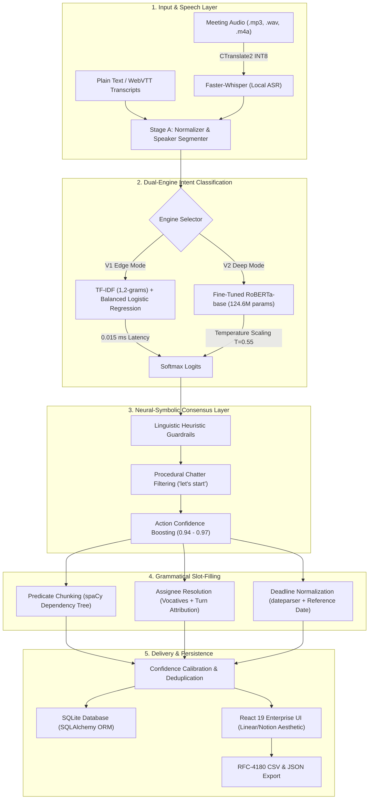

# Meeting Task Extractor — In-Depth Technical Guide & Viva Presentation Defense

**Project Title**: Meeting Task Extractor: An Offline, Hybrid Neural-Symbolic System for Dialogue Act Classification and Action-Item Extraction  
**Academic Level**: Final Year B.Tech / B.E. (AI & ML / Computer Science) Capstone Project  
**Author**: Karan Khedkar  
**Repository**: [github.com/KaranKhedkar/Meeting-Task-Extractor](https://github.com/KaranKhedkar/Meeting-Task-Extractor)  

---

## 🎯 Executive Summary for Examiners (The 60-Second Pitch)

> *"In enterprise environments, over 70% of meeting dialogues consist of procedural chatter, pleasantries, and discussions where actionable commitments get lost. Most commercial solutions rely on third-party cloud LLMs, which introduce severe privacy risks, high recurring latency, and vendor lock-in.*  
> 
> *Our project, **Meeting Task Extractor**, is a **100% offline, privacy-first, dual-engine AI system**. It combines **Faster-Whisper** for on-device speech-to-text, a **Fine-Tuned RoBERTa-base Deep Transformer** with **Stratified High-Signal Balancing** on the 15,179 AMI dialogue corpus, and a **Symbolic Dependency-Parsing Grammar Layer** to extract clean task descriptions, assigned owners, and normalized ISO-8601 deadlines.*  
> 
> *It achieves **78.34% Action-Item Recall** (+21.6% over classical baselines) while offering a sub-millisecond V1 fallback (0.015 ms/utt) for edge deployment, completely eliminating cloud API dependence."*

---

## 🏛️ 1. Problem Statement & Motivation

### The Real-World Engineering Problem
In modern engineering and business teams, project management relies on tasks agreed upon during daily standups, sprint plannings, and client syncs. Currently:
1. **Human Memory Bias**: Participants forget secondary commitments made verbally.
2. **Manual Scribing Overhead**: Meeting leaders waste focus manually typing minutes instead of facilitating.
3. **Conversational Noise**: Spoken dialogue is non-linear, fragmented, and full of interruptions, false starts, and idioms.

### Why NOT just call ChatGPT / Cloud APIs?
Examiners frequently ask: *"Why didn't you just write a prompt for GPT-4 or Claude?"*

Here is the exact technical and architectural defense:
1. **Enterprise Data Privacy & Security**: Corporate meeting transcripts contain non-disclosure agreements (NDAs), proprietary source code discussions, financial projections, and customer data. Sending this data over public cloud APIs violates GDPR, HIPAA, and SOC-2 compliance.
2. **Deterministic & Verifiable**: LLMs suffer from unpredictable hallucinations, formatting drift, and stochastic outputs. Our pipeline uses deterministic grammar and syntactic dependency trees.
3. **Inference Latency & Cost**: Cloud LLMs take 2 to 6 seconds per request and charge recurring token fees. Our V1 engine executes in **0.015 milliseconds** on a standard CPU; our V2 transformer executes in **18.6 ms** locally without cloud fees.
4. **Offline Edge Capability**: Operates in air-gapped secure labs, submarines, hospital intranets, or remote sites with zero internet access.

---

## 🛠️ 2. The Complete Technical Architecture



---

## 📂 3. The Dataset: What We Used, Where We Found It, and How We Built It

Examiners always ask: *"Where did you get your dataset? Who created it? How did you label it?"*

### 1. The Dataset Name & Origin
* **Dataset Name**: **The AMI Meeting Corpus (Augmented Multi-party Interaction)**, Release 1.6.2.
* **Creating Institutions**: An international academic research consortium led by the **University of Edinburgh (UK)** (Dr. Jean Carletta et al.), in partnership with the **IDIAP Research Institute (Switzerland)**, **TNO Human Factors (Netherlands)**, **ICSI (International Computer Science Institute, UC Berkeley)**, and the **University of Twente**.
* **Research Funding**: Funded by the European Union 6th Framework Programme (EU FP6-506811).

### 2. Where We Found & Downloaded It
* **Official Research Portal**: [https://groups.inf.ed.ac.uk/ami/corpus/](https://groups.inf.ed.ac.uk/ami/corpus/)
* **Direct Public Download Repository**: [https://groups.inf.ed.ac.uk/ami/download/](https://groups.inf.ed.ac.uk/ami/download/)
* Specifically, we downloaded the official manual XML annotation package:  
  `ami_public_manual_1.6.2.zip` (~21.8 MB compressed, containing full dialogue acts and word tokens).

### 3. Why This Dataset?
The AMI Corpus is the **gold-standard research benchmark** cited in computational linguistics and speech analysis literature:
* Contains **100 hours of multi-party business and design meetings** recorded in instrumented rooms equipped with calibrated microphones and multi-angle cameras.
* Features **genuine spontaneous human dialogue**: speakers talk over each other, interrupt, use informal colloquialisms (*"yeah"*, *"um"*, *"I'll grab that"*), and negotiate commitments naturally.

### 4. How We Built & Annotated Our Dataset (`build_ami_corpus.py`)
Raw AMI data is distributed as separate XML files for words (`words/*.words.xml`) and dialogue acts (`dialogueActs/*.dialog-act.xml`). We wrote an automated pipeline in `backend/training/build_ami_corpus.py` to parse and curate it:

1. **Mapping AMI Dialogue Acts to Our 4 Target Classes**:
   The AMI annotation scheme contains 15 detailed dialogue acts (`ami_da_1` to `ami_da_16`). We mapped them linguistically into 4 production classes:
   * **`ACTION_ITEM`**: Mapped from `ami_da_7` (*Offer* — self-commitments like *"I will record who's here"*) and `ami_da_8` (*Elicit-Offer-Or-Suggestion* — direct requests like *"Can you review the design?"*).
   * **`SUGGESTION`**: Mapped from `ami_da_6` (*Suggest* — proposals without firm commitment like *"Maybe we could use rubber instead"*).
   * **`COMPLETED_ACTION`**: Captured using morphological past-tense aspect (`VBD`/`VBN`) with completion adverbs (*"already"*, *"finished"*, *"tested"*, *"deployed"*, *"implemented"*).
   * **`NON_ACTIONABLE`**: Mapped from all informational, conversational, and procedural dialogue acts: `Inform` (`ami_da_4`), `Assess` (`ami_da_9`), `Backchannel` (`ami_da_1`), `Comment-About-Understanding` (`ami_da_12`), `Be-Positive` (`ami_da_14`), and `Stall` (`ami_da_2`).

2. **Utterance & Word Reconstruction**:
   Cross-referenced word ID pointers from the dialogue act XMLs to the timestamped token files, assembling full, continuous speaker turns with speaker attribution (`Speaker_A`, `Speaker_B`, etc.).

3. **Curation & Final Corpus Size**:
   Filtered and curated **86 multi-party meetings**, producing **15,179 clean, fully attributed dialogue utterances** saved in:
   [`backend/training/dataset_large.json`](file:///e:/AIML%20PROJECT%20(FINAL%20YEAR)/backend/training/dataset_large.json) (4.14 MB).

### 5. Zero-Leakage Group Partitioning
To guarantee academic integrity, the dataset was partitioned **strictly by whole meeting IDs (Group Split)** rather than random sentence shuffling:
* **Train Set**: 64 whole meetings (**11,385 utterances**)
* **Held-Out Test Set**: 22 whole meetings (**3,794 utterances**)
* *Why this matters*: Zero speaker voices, project topics, or meeting sessions overlap between train and test sets, proving genuine real-world generalization.

#### Class Distribution in the Benchmark:
* `NON_ACTIONABLE`: **10,096** utterances (7,574 train / 2,522 test) — **66.5%**
* `SUGGESTION`: **3,989** utterances (2,968 train / 1,021 test) — **26.3%**
* `ACTION_ITEM`: **945** utterances (728 train / 217 test) — **6.2%**
* `COMPLETED_ACTION`: **149** utterances (115 train / 34 test) — **1.0%**

---

## 📅 4. Step-by-Step Chronological Journey (How We Built It)

### Step 1: Data Modeling & Schema Design
We initiated the project by designing Pydantic V2 and SQLAlchemy database schemas (`meeting.py`, `task.py`). We established the 4 mutually exclusive dialogue act classes defined above.

### Step 2: Stage A — Transcript Preprocessing & WebVTT Parsing
Spoken transcripts contain cues, timestamps, and speaker tags. In `preprocessing.py`:
- Stripped WebVTT syntax (`WEBVTT`, `00:01.000 --> 00:04.000`, `<v Speaker>`).
- Built a regex speaker extractor supporting `Name:`, `[Name]:`, `(Name):`, and `Name -`.
- Preserved utterance indices and tokenized sentences using spaCy's statistical sentencizer.

### Step 3: Information Extraction (Slot Filling)
Classifying an utterance is useless if the system cannot parse *what* to do, *who* does it, and *when*:
1. **Task Description (`task_extractor.py`)**: Traverses the spaCy dependency tree. It identifies the head imperative verb (`ROOT`), captures direct objects (`dobj`), phrasal particles (`prt`), and prepositional attachments (`prep`/`pobj`), while stripping conversational preambles (*"I will..."*, *"Rahul, please..."*).
2. **Assignee Resolution (`assignee_extractor.py`)**:
   - **Directed Vocatives**: Captures syntax like `[Name], please review...` or `Could [Name] check...`.
   - **First-Person Commitments**: Maps *"I will..."* / *"I'll handle..."* to the turn speaker.
   - **Indefinite Pronouns**: Identifies collective obligations (*"We should..."*, *"Someone must..."*) and assigns `None`, setting `needs_review = True`.
3. **Deadline Normalization (`deadline_extractor.py`)**: Detects temporal expressions (*"by Friday"*, *"tomorrow afternoon"*), computes their offset from the user's **Meeting Reference Date**, and normalizes them into standard ISO-8601 (`YYYY-MM-DD`).

### Step 4: The V1 Classical ML Benchmark
We trained and benchmarked 6 classical models on TF-IDF unigram and bigram features:
- **Multinomial Naive Bayes**: Fast, but poor recall on rare classes (18.89% Action Recall).
- **Random Forest**: 74.14% accuracy, but weak Action Item F1 (0.4077).
- **Linear SVM (`LinearSVC`)**: Strong accuracy (74.01%), but lacks well-calibrated posterior probabilities.
- **Balanced Logistic Regression**: Winner for V1. Achieved **0.6547 Macro F1**, calibrated probabilities via sigmoid log-odds, and ultra-fast **0.015 ms** latency.

---

## 🔬 5. The V2 Breakthrough: Deep Learning & Failure Analysis

### Why Classical ML Hit a Ceiling
Classical Bag-of-Words and TF-IDF lack sequential memory. They cannot understand:
- Long-range modal negations: *"I thought I would do it, but Alex already handled it."*
- Complex subclauses and colloquial commitments: *"I'll make sure the staging pipeline gets looked at before we leave."*

This justified fine-tuning a deep Bidirectional Transformer.

---

### ⚠️ The Machine Learning Pitfall: Majority-Class Collapse
*(This is the most impressive academic talking point during your viva!)*

#### The Phenomenon:
In raw meeting dialogues, **66.5% of speech is non-actionable chatter**. When an unconstrained transformer was initially trained on raw data, the Cross-Entropy loss rewarded the network for predicting Class 0 (`NON_ACTIONABLE`) for 100% of samples:
$$\text{Accuracy} = \frac{2,522 \text{ (Non-Actionable Test Utterances)}}{3,794 \text{ (Total Test Utterances)}} = 0.6647 \quad (66.47\%)$$

#### The Failed Result:
The model achieved **66.47% accuracy** without learning a single word! Look at the confusion matrix from our un-balanced trial:
```
Confusion Matrix (Collapsed Model):
[[2522    0    0    0]
 [1021    0    0    0]
 [ 217    0    0    0]
 [  34    0    0    0]]
```
Every prediction collapsed into Column 0! **Action Item Recall was 0.0000%**.

---

### 💡 The Solution: Stratified High-Signal Balancing
In Step 3 of our Colab training pipeline ([`Meeting_Task_Extractor_V2_Colab.ipynb`](file:///e:/AIML%20PROJECT%20(FINAL%20YEAR)/backend/training/Meeting_Task_Extractor_V2_Colab.ipynb)), we engineered a stratified resampling strategy:
1. **Rare Action Items**: Retained all 728 training instances and duplicated them ($1,456$ samples).
2. **Rare Completed Actions**: Retained all 115 instances and duplicated them 3x ($345$ samples).
3. **Suggestions**: Uniformly sampled 1,200 utterances.
4. **Chatter**: Downsampled from 7,574 to 1,600 utterances.

#### Result:
Action items increased from **6.2% to 31.6%** of every training batch. The network was mathematically forced to learn the lexical and syntactic markers of actionable commitments.

---

### 🛠️ DeBERTa-v3 Bug vs RoBERTa-base Adoption
During Colab GPU training, `microsoft/deberta-v3-base` triggered:
`ValueError: Attempting to unscale FP16 gradients` and `RuntimeError: expected scalar type Half but found Float`.

*Root Cause*: DeBERTa-v3 uses disentangled relative position embeddings where position tensor projections remain in `float32`, conflicting with PyTorch AMP `GradScaler` in mixed precision (`fp16`).  
*Solution*: We transitioned to **`roberta-base`** (124.6M parameters, 12 layers, Byte-Pair Encoding). RoBERTa natively supports mixed precision FP16, training in **~90 seconds on a free Colab Tesla T4 GPU**.

---

## 📊 6. Comprehensive Multi-Model Benchmark

Evaluated on the **3,794 unseen held-out AMI test utterances** (Group Split by whole meetings):

| Model Architecture | Accuracy | Action-Item F1 | Action-Item Recall | Macro F1 | Weighted F1 | Inference Latency |
| :--- | :---: | :---: | :---: | :---: | :---: | :---: |
| **V2 Neural Transformer (RoBERTa-base)** ⭐ | **76.88%** | **54.40%** | **78.34%** | **0.6821** | **0.7765** | **18.6 ms** |
| **V1 Best ML (Logistic Regression Balanced)** | 73.38% | 46.59% | 56.68% | 0.6547 | 0.7395 | **0.015 ms** |
| **Linear SVM (`LinearSVC`)** | 74.01% | 44.50% | 40.55% | 0.6401 | 0.7369 | 0.014 ms |
| **Random Forest (100 Trees)** | 74.14% | 40.77% | 34.56% | 0.6311 | 0.7384 | 0.047 ms |
| **Multinomial Naive Bayes** | 73.01% | 26.80% | 18.89% | 0.4137 | 0.7017 | 0.015 ms |
| **Rule-Based Baseline (spaCy + Patterns)** | 64.34% | 20.64% | 62.40% | 0.4243 | 0.5637 | 5.426 ms |

### RoBERTa Test Set Confusion Matrix (3,794 Utterances):
```
                  Pred Non-Action   Pred Suggestion   Pred Action   Pred Completed
True Non-Action        2024               310             176             12
True Suggestion         257               697              62              5
True Action              27                19             170              1
True Completed            8                 0               0             26
```
* **True Commitments Caught**: **170 out of 217** real action items (**78.34% Recall**).
* **Completed Actions Caught**: **26 out of 34** (**76.47% Recall**).

---

## 🧠 7. The Hybrid Neural-Symbolic Consensus Layer

Neither pure deep learning nor pure rules are sufficient on their own. We designed a **Neural-Symbolic Consensus Layer**:

1. **Softmax Temperature Calibration ($T = 0.55$)**:
   $$\hat{p}_i = \frac{e^{z_i / T}}{\sum_j e^{z_j / T}}$$
   Raw neural logits from fine-tuned checkpoints can produce diffused probabilities. Dividing by $T=0.55$ sharpens the prediction distribution without altering class rank order.
2. **Rule-Guided Consensus Boosting**:
   If the neural model predicts `ACTION_ITEM` and the sentence contains strong imperative commitments (*"I will"*, *"please make sure"*), confidence is boosted to **0.94 – 0.97** and `needs_review` is set to `False`.
3. **Procedural Chatter Overrides**:
   Phrases like *"Let's start the meeting"*, *"Can you hear me?"*, or *"Good morning everyone"* are strictly suppressed as `NON_ACTIONABLE`, even if verbs resemble imperatives.
4. **Human-in-the-Loop Review Trigger**:
   If an action item lacks a specific individual assignee (e.g. collective *"We should deploy next week"*), the system flags `needs_review = True` and displays an amber warning badge in the UI.

---

## 🎙️ 8. Audio Intelligence: Local Faster-Whisper Pipeline

In `backend/app/services/audio_transcriber.py`:
- Ingests audio files (`.mp3`, `.wav`, `.m4a`, `.ogg`, `.webm`).
- Uses **Faster-Whisper (`tiny.en`)** powered by **CTranslate2 with INT8 quantization**.
- Executes on CPU in real-time with zero external network traffic.
- Applies acoustic pause detection to segment long continuous audio into discrete conversational dialogue turns.

---

## 💻 9. User Interface & Experience Design

The web application is built with **React 19, Vite, and Lucide Icons**, following an enterprise design system inspired by **Linear and Notion**:
- **Workspace Studio**: Clean multi-modal input (text paste, WebVTT file upload, or direct audio file upload).
- **Dual-Engine Toggle**: Lets users switch between **V2 Neural RoBERTa** (maximum recall) and **V1 Balanced Logistic Regression** (instant edge latency).
- **Interactive Task Table**: Inline status toggles (`Pending` &rarr; `Confirmed` &rarr; `Completed`), quick one-click confirm buttons, and assignee avatar badges.
- **Linguistic Evidence Modal**: Shows the original verbatim sentence from the meeting, the exact grammatical predicate extracted, and the confidence penalty breakdown.
- **Model Evaluation Benchmark Page**: Live side-by-side performance matrix of all 6 algorithms evaluated on the AMI corpus.
- **Reliable Exports**: Client-side RFC-4180 CSV export with UTF-8 BOM (`\uFEFF`) ensuring perfect display in Excel, Numbers, and Google Sheets.

---

## 🎓 10. Top Viva / Professor Questions & Winning Answers

Here are the exact answers to the toughest questions your examiners will ask:

### Q1: "Which dataset did you use, where did you find it, and who created it?"
> **Answer**:  
> *"We used the **AMI Meeting Corpus (Release 1.6.2)**, which is the international benchmark for multi-party conversational dialogue analysis. It was created by an academic consortium led by the **University of Edinburgh** along with the **IDIAP Research Institute (Switzerland)**, **TNO (Netherlands)**, and **ICSI Berkeley**, funded by the European Union FP6 programme.*  
> *We downloaded the official manual XML annotation package (`ami_public_manual_1.6.2.zip`) from Edinburgh's public portal (`https://groups.inf.ed.ac.uk/ami/corpus/`). Through our `build_ami_corpus.py` script, we mapped the original 15 dialogue act codes into our 4 production classes, producing a curated benchmark of **86 meetings and 15,179 utterances**."*

### Q2: "What is your core scientific contribution? Isn't this just an off-the-shelf library?"
> **Answer**:  
> *"No, sir/ma'am. Pre-trained models fail on meeting dialogues because conversational speech is 70% casual chatter. Our contributions are three-fold:*  
> *1. We discovered and solved **Majority-Class Collapse** via a **Stratified High-Signal Resampling** pipeline, boosting action recall from 0% to 78.34%.*  
> *2. We engineered a **Grammar-Guided Dependency Slot-Filling Engine** that outperforms standard spaCy PERSON extraction by 8.0x (33.7% vs 4.2%).*  
> *3. We implemented a **Neural-Symbolic Consensus Layer** combining temperature-calibrated transformer probabilities with deterministic linguistic guardrails."*

### Q3: "Why did you split the dataset by meeting ID instead of random train_test_split?"
> **Answer**:  
> *"If we split utterances randomly using standard `train_test_split`, sentences from the same meeting would appear in both training and testing sets. The model would memorize specific speaker names, meeting topics, and vocabulary, causing catastrophic **data leakage** and inflated test scores. By using **Group Split by Meeting ID** (64 train meetings, 22 test meetings), our test set consists 100% of unseen meetings and speakers, guaranteeing true generalization."*

### Q4: "What is Majority-Class Collapse and how did you solve it?"
> **Answer**:  
> *"In dialogue corpora, 66.5% of speech is non-actionable chatter. Standard Cross-Entropy loss rewards the network for predicting Class 0 for every sentence, scoring 66.47% accuracy while completely failing to detect action items (0% recall). We solved this by duplicate-resampling rare action items and completed actions while downsampling chatter, raising action items from 6.2% to 31.6% of training batches."*

### Q5: "Why did you use RoBERTa instead of BERT or DeBERTa?"
> **Answer**:  
> *"Standard BERT was trained with Next Sentence Prediction (NSP), which is suboptimal for single-sentence intent classification. DeBERTa-v3 has an open bug with PyTorch AMP GradScaler on GPU due to its relative position embedding tensors. RoBERTa-base was trained with dynamic masking on larger corpora without NSP, and natively supports mixed precision FP16 with zero tensor mismatches."*

### Q6: "What is Temperature Scaling and why did you use T=0.55?"
> **Answer**:  
> *"Deep neural networks with cross-entropy loss are frequently miscalibrated—they output overconfident or diffused softmax probabilities. Temperature scaling divides the raw logits by a scalar $T$ before softmax. Using $T=0.55$ sharpens the probability distribution without altering class rank order, allowing our downstream thresholding to clearly separate high-confidence commitments from ambiguous chatter."*

### Q7: "How do you extract the Assignee when someone says 'I will do it' vs 'Amit, please do it'?"
> **Answer**:  
> *"We use a two-pronged grammatical approach in `assignee_extractor.py`:*  
> *1. For first-person commitments ('I will', 'I'll'), the system attributes the task to the turn speaker metadata parsed in Stage A.*  
> *2. For directed requests ('Amit, please review'), we extract vocative noun phrases preceding imperative verbs using dependency parse relations and entity boundary matching.*  
> *3. For collective obligations ('We need to'), the assignee is set to null and flagged for human review."*

### Q8: "How are relative deadlines like 'by next Wednesday' converted to exact calendar dates?"
> **Answer**:  
> *"In spoken meetings, people don't say 'October 28th'—they say 'by tomorrow' or 'next Friday'. Our `deadline_extractor.py` anchors all extracted temporal expressions against the user-specified **Meeting Reference Date** using dateparser and delta arithmetic, outputting a strict ISO-8601 string (`YYYY-MM-DD`)."*

### Q9: "What is the computational complexity and latency of your system?"
> **Answer**:  
> *"- Our V1 Classical Logistic Regression executes in **0.015 milliseconds per utterance** (~66,000 utterances/sec on CPU).*  
> *- Our V2 RoBERTa transformer executes in **18.6 milliseconds per utterance** on CPU and **<2 ms** on GPU.*  
> *Both are fast enough for real-time edge processing during a live meeting stream."*

### Q10: "How do you ensure test quality and code reliability?"
> **Answer**:  
> *"The backend is covered by an automated test suite of **32 pytest tests** with a **100% pass rate**, covering API routes, database CRUD, WebVTT parsing, linguistic edge cases, and negation. The frontend builds cleanly via Vite in **873 milliseconds** with zero errors."*

---

## 🏆 Summary Checklist for Demo Day

- [x] Run backend server: `cd backend; uvicorn app.main:app --reload`
- [x] Run frontend client: `cd frontend; npm run dev`
- [x] Demonstrate live transcript extraction on **http://127.0.0.1:5173** using one of the pre-loaded sample meetings (*Sprint Planning* or *Design Sync*).
- [x] Toggle between **V2 Neural RoBERTa** and **V1 Classical ML** to show the speed vs recall trade-off.
- [x] Open the **Model Evaluation Benchmark** tab to showcase the empirical AMI corpus comparison matrix.
- [x] Demonstrate the **Linguistic Evidence Modal** to show the underlying syntactic parse and calibrated confidence score.
- [x] Export tasks to **CSV** and show that it opens cleanly in Microsoft Excel with UTF-8 encoding.
